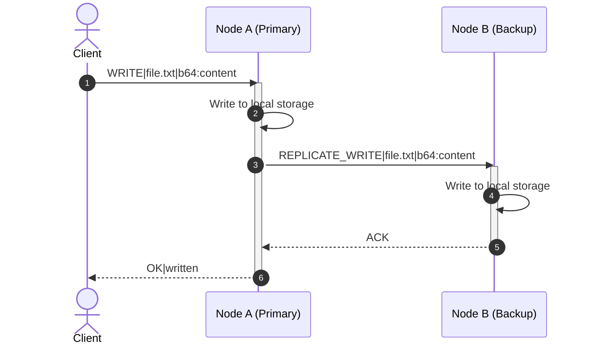
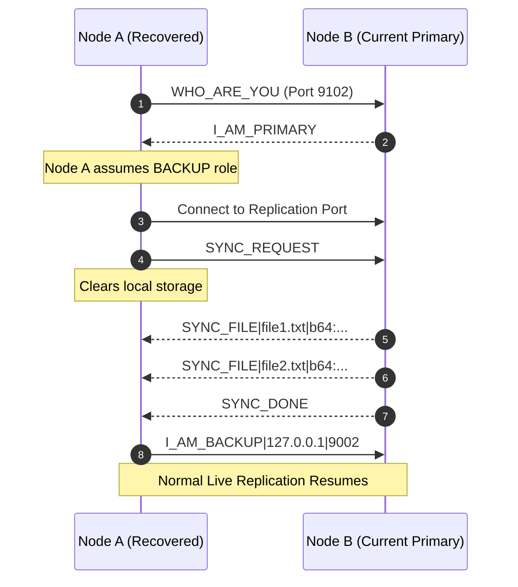

# pyDFS: Fault-Tolerant Distributed File System

A lightweight, fault-tolerant, replicated distributed file system built for Distributed Computing Systems (DCS). **pyDFS** implements a Primary-Backup replication architecture featuring automatic peer discovery, crash detection, automatic backup promotion (leader election), transparent client failover, state synchronization upon node recovery, sandboxed storage, and a real-time web monitoring dashboard.

---

## Table of Contents

- [Overview](#overview)
- [Key Features](#key-features)
- [System Architecture](#system-architecture)
  - [Topology & Port Allocation](#topology--port-allocation)
  - [Replication & Consistency](#replication--consistency)
  - [Crash Detection & Failover Mechanism](#crash-detection--failover-mechanism)
  - [Node Recovery & State Synchronization](#node-recovery--state-synchronization)
- [Protocol Specification](#protocol-specification)
  - [Framing & Encoding](#framing--encoding)
  - [Message Types](#message-types)
- [Repository Structure](#repository-structure)
- [Prerequisites & Installation](#prerequisites--installation)
- [How to Run](#how-to-run)
  - [Option 1: Automated End-to-End Test Suite](#option-1-automated-end-to-end-test-suite)
  - [Option 2: Running via Command Line (Manual)](#option-2-running-via-command-line-manual)
  - [Option 3: Real-Time Web Dashboard](#option-3-real-time-web-dashboard)
- [Client Interactive Shell](#client-interactive-shell)
- [Configuration & Environment Variables](#configuration--environment-variables)
- [Distributed Systems Concepts Demonstrated](#distributed-systems-concepts-demonstrated)

---

## Overview

In distributed computing, ensuring data availability and consistency despite server crashes is a fundamental challenge. **pyDFS** demonstrates a robust solution using a **Primary-Backup** model:
- **Zero External Dependencies for Core DFS**: The entire distributed storage system, protocol layer, client, and server run using pure Python standard library sockets and threading.
- **Synchronous Primary-to-Backup Replication**: File operations (`WRITE`, `UPDATE`, `DELETE`) are processed by the primary server and replicated synchronously to all active backup nodes.
- **High Availability & Fault Tolerance**: When a primary node crashes, the backup node detects connection loss, promotes itself to Primary, and immediately begins serving client operations.
- **Self-Healing State Sync**: When a failed node rejoins the cluster, it auto-discovers the active primary, connects as a backup, wipes stale state, and downloads a complete state synchronization before accepting live traffic.
- **Real-Time Monitoring UI**: An optional FastAPI + WebSocket dashboard provides dynamic topology visualization, real-time node metrics, live event streams, and one-click chaos testing triggers.

---

## Key Features

- **Dynamic Role Auto-Discovery**: Nodes determine whether to become `PRIMARY` or `BACKUP` on boot by probing peers.
- **Transparent Client Failover**: If the primary becomes unresponsive or drops connection, the client seamlessly shifts traffic to fallback nodes with configurable timeouts and retries.
- **Sandboxed Local Storage**: All file operations are relative to a designated storage root, strictly sanitized to prevent directory traversal attacks (`../`).
- **Resilient Wire Protocol**: Line-based ASCII framing with Base64 payload encoding protects against payload delimiter collision (newlines and pipe characters inside file contents).
- **Chaos-Tested E2E Verification**: Comprehensive 11-step automated verification covering cluster boot, write, crash injection, failover write, node recovery, state sync, and fail-back.
- **Interactive Web Dashboard**: Graphical node controls (Start, Stop, Crash, Recover, Reset Storage), interactive client operations workbench, and SVG-rendered live route topology.

---

## System Architecture

```
                  +-----------------------------------+
                  |            DFS Client             |
                  |     (Transparent Failover)        |
                  +-----------------+-----------------+
                                    |
                    Client Traffic  |   Failover Route
                      (Port 9001)   |    (Port 9101)
                                    v
          +-------------------------+-------------------------+
          |                                                   |
          v                                                   v
+-----------------------+                           +-----------------------+
|     Node A (Primary)  |                           |     Node B (Backup)   |
|   Storage: storage_a  |       Replication         |   Storage: storage_b  |
|                       |-------------------------->|                       |
|   Client Port : 9001  |        (Port 9002)        |   Client Port : 9101  |
|   Repl Port   : 9002  |                           |   Repl Port   : 9102  |
+-----------------------+                           +-----------------------+
```

### Topology & Port Allocation

Each server instance binds two separate TCP sockets:
1. **Client Port**: Dedicated to receiving client file operations (`READ`, `WRITE`, `UPDATE`, `DELETE`).
2. **Replication Port**: Dedicated to peer discovery, replication traffic from the primary, and state synchronization.

| Node Identity | Default Host | Client Port | Replication Port | Default Storage Path |
| :--- | :--- | :--- | :--- | :--- |
| **Node A (Primary)** | `127.0.0.1` | `9001` | `9002` | `./dfs_storage` / `./storage_a` |
| **Node B (Backup)** | `127.0.0.1` | `9101` | `9102` | `./dfs_storage` / `./storage_b` |

### Replication & Consistency



1. The client issues a modification command (`WRITE`, `UPDATE`, or `DELETE`) to the Primary.
2. The Primary applies the change to its sandboxed local disk.
3. The Primary replicates the mutation over the persistent replication socket to all connected Backups.
4. Each Backup applies the mutation and replies with an acknowledgement (`ACK`).
5. The Primary responds to the client with `OK|...`.

### Crash Detection & Failover Mechanism

1. **Failure Detection**: The Backup node maintains a persistent TCP stream with the Primary's replication port. A crash or abrupt termination of the Primary drops this connection.
2. **Auto-Promotion**: The Backup detects the connection closure (`readline()` returning empty), unbinds from the old Primary, promotes its internal state to `PRIMARY`, and opens its client listener for write requests.
3. **Client Failover**: The client detects a socket timeout or refusal when contacting the old Primary. It automatically rotates to the next server entry (`Node B` on port 9101) and retries the pending request.

### Node Recovery & State Synchronization



When a crashed node restarts:
1. It queries its peers with `WHO_ARE_YOU`.
2. The active primary identifies itself (`I_AM_PRIMARY`).
3. The recovering node joins as a `BACKUP` and issues a `SYNC_REQUEST`.
4. It wipes its local storage directory to prevent stale/divergent files.
5. The primary streams all current files via `SYNC_FILE` commands followed by `SYNC_DONE`.
6. The node registers as an active live backup (`I_AM_BACKUP`).

---

## Protocol Specification

### Framing & Encoding
- **Wire Format**: Plain-text, pipe-delimited (`|`), terminated by a newline (`\n`).
  ```text
  COMMAND|arg1|arg2|...\n
  ```
- **Payload Encoding**: User file contents and payloads are prefixed with `b64:` and encoded in Base64 (e.g. `b64:SGVsbG8gV29ybGQ=`). This guarantees that user files containing newlines, spaces, or pipe symbols will never disrupt socket stream framing.

### Message Types

#### 1. Client to Server
| Command | Arguments | Description | Example |
| :--- | :--- | :--- | :--- |
| `READ` | `<path>` | Fetch file content | `READ|notes.txt\n` |
| `WRITE` | `<path>\|<b64_content>` | Create or overwrite file | `WRITE|notes.txt\|b64:aGVsbG8=\n` |
| `UPDATE` | `<path>\|<b64_content>` | Modify existing file | `UPDATE|notes.txt\|b64:bmV3\n` |
| `DELETE` | `<path>` | Remove a file | `DELETE|notes.txt\n` |

#### 2. Server Responses
| Response | Description | Example |
| :--- | :--- | :--- |
| `OK\|<b64_payload>` | Success with optional encoded payload | `OK\|b64:d29ybGQ=\n` |
| `ERR\|<reason>` | Operation failed | `ERR\|File not found: notes.txt\n` |
| `ERR\|NOT_PRIMARY` | Server is currently a backup; triggers client redirect | `ERR\|NOT_PRIMARY\n` |

#### 3. Inter-Node Replication & Discovery
| Message | Direction | Description |
| :--- | :--- | :--- |
| `WHO_ARE_YOU` | Discovery | Probe peer identity |
| `I_AM_PRIMARY` | Peer $\rightarrow$ Discovery | Peer reports active primary status |
| `I_AM_BACKUP\|<host>\|<port>` | Backup $\rightarrow$ Primary | Backup registers for live replication |
| `REPLICATE_WRITE\|<path>\|<b64>` | Primary $\rightarrow$ Backup | Propagate write operation |
| `REPLICATE_UPDATE\|<path>\|<b64>` | Primary $\rightarrow$ Backup | Propagate update operation |
| `REPLICATE_DELETE\|<path>` | Primary $\rightarrow$ Backup | Propagate deletion operation |
| `SYNC_REQUEST` | Backup $\rightarrow$ Primary | Request initial state dump |
| `SYNC_FILE\|<path>\|<b64>` | Primary $\rightarrow$ Backup | File payload transfer during sync |
| `SYNC_DONE` | Primary $\rightarrow$ Backup | Indicates sync completion |

---

## Repository Structure

```
Distributed_file_system_dev_byte/
├── config.py             # Cluster topology, timeouts, ports, and defaults
├── protocol.py           # Message encoders, decoders, base64 payload handlers
├── storage.py            # Local disk filesystem abstraction & path sandboxing
├── server.py             # Server daemon (Primary/Backup logic, auto-discovery)
├── client.py             # Client CLI & library with automatic failover
├── test_scenario.py      # Automated 11-step end-to-end chaos test
├── requirements.txt      # Web UI dependencies (FastAPI, Uvicorn, Jinja2, etc.)
└── ui/                   # Real-time Web Dashboard
    ├── app.py            # FastAPI backend & WebSocket event hub
    ├── process_manager.py# Process controller for cluster node lifecycles
    ├── state.py          # Asynchronous event bus
    ├── static/           # Dashboard CSS and JavaScript
    └── templates/        # Jinja2 HTML templates (dashboard, client, node)
```

---

## Prerequisites & Installation

### Core DFS
- **Python 3.8+**
- No external packages required! (Uses standard library `socket`, `threading`, `argparse`, `base64`, `shutil`, `subprocess`).

### Optional Web Dashboard
To run the interactive web management interface:
```bash
pip install -r requirements.txt
```

---

## How to Run

### Option 1: Automated End-to-End Test Suite

The test suite runs an end-to-end chaos test verifying the entire lifecycle:
```bash
python test_scenario.py
```

**Test steps executed:**
1. Starts Primary Server (Port 9001 / 9002).
2. Starts Backup Server (Port 9101 / 9102).
3. Client writes `test_file.txt`.
4. Client reads back and asserts content.
5. Injects crash into the Primary server.
6. Client reads file again (verifying transparent failover to Backup).
7. Client writes `failover_file.txt` to promoted Backup.
8. Restarts old Primary server (it rejoins as Backup and executes state sync).
9. Client verifies recovered node acts as Backup and redirects properly.
10. Injects crash into the new Primary to force fail-back to the recovered node.
11. Reads all files to verify zero data loss.

---

### Option 2: Running via Command Line (Manual)

#### 1. Start Server A (Primary)
Open a terminal and run:
```bash
python server.py --storage ./storage_a --client-port 9001 --repl-port 9002
```
*Output: `*** ROLE: PRIMARY ***`*

#### 2. Start Server B (Backup)
Open a second terminal and run:
```bash
python server.py --storage ./storage_b --client-port 9101 --repl-port 9102
```
*Output: `*** ROLE: BACKUP (primary at 127.0.0.1:9002) ***`*

#### 3. Start the Interactive Client
Open a third terminal and run:
```bash
python client.py
```

---

### Option 3: Real-Time Web Dashboard

Launch the FastAPI dashboard server:
```bash
uvicorn ui.app:app --host 127.0.0.1 --port 8000 --reload
```
Open your browser and navigate to:
```
http://127.0.0.1:8000
```

#### Dashboard Features:
- **Topology Map**: Visualizes the active link from the Client to the current Primary, with dynamic failover routes.
- **Node Controls**: Start or Stop individual nodes, crash the Primary on demand, or recover nodes with one click.
- **Client Workbench**: Perform interactive `READ`, `WRITE`, `UPDATE`, and `DELETE` requests directly from the UI.
- **Live Event Stream**: Real-time WebSocket terminal showing every socket message, heartbeat event, and failover occurrence.

---

## Client Interactive Shell

When running `python client.py`, an interactive prompt is available:

```text
Distributed File System Client
Commands: READ <path> | WRITE <path> <content> | UPDATE <path> <content> | DELETE <path> | quit
--------------------------------------------------
> WRITE demo.txt Hello Distributed Systems!
OK|written

> READ demo.txt
OK|Hello Distributed Systems!

> UPDATE demo.txt Distributed Computing is Fun!
OK|updated

> READ demo.txt
OK|Distributed Computing is Fun!

> DELETE demo.txt
OK|deleted

> quit
Bye!
```

---

## Configuration & Environment Variables

Settings in `config.py` can be customized via environment variables:

| Variable | Default Value | Description |
| :--- | :--- | :--- |
| `DFS_PRIMARY_HOST` | `127.0.0.1` | Hostname/IP of Primary server |
| `DFS_BACKUP_HOST` | `127.0.0.1` | Hostname/IP of Backup server |
| `DFS_PRIMARY_CLIENT_PORT` | `9001` | Primary client TCP port |
| `DFS_PRIMARY_REPL_PORT` | `9002` | Primary replication TCP port |
| `DFS_BACKUP_CLIENT_PORT` | `9101` | Backup client TCP port |
| `DFS_BACKUP_REPL_PORT` | `9102` | Backup replication TCP port |
| `DFS_STORAGE_ROOT` | `./dfs_storage` | Default local storage folder |
| `CLIENT_TIMEOUT_SECONDS` | `2.0` | Client socket read timeout before failover |
| `RECOVERY_RETRY_INTERVAL_SECONDS`| `2.0` | Interval between node recovery reconnect attempts |

---

## Distributed Systems Concepts Demonstrated

1. **Active Primary-Backup Replication**: Guarantees durability and consistency by synchronizing changes across replicas prior to acknowledging writes.
2. **Crash-Stop Failure Model**: Robust socket drop detection handling ungraceful process terminations.
3. **Leader Promotion**: Autonomous role change when primary heartbeat vanishes without split-brain in a two-node setup.
4. **State Machine Catch-Up / State Transfer**: Total state reconstitution (`SYNC_REQUEST` / `SYNC_FILE`) for lagging or recovered nodes.
5. **Path Sandboxing & Security**: Defensive filesystem boundaries preventing path traversal exploits outside the storage root.
6. **Transparent Client Resiliency**: Decoupling clients from physical node IP/port specifics through automated failover rotation.

